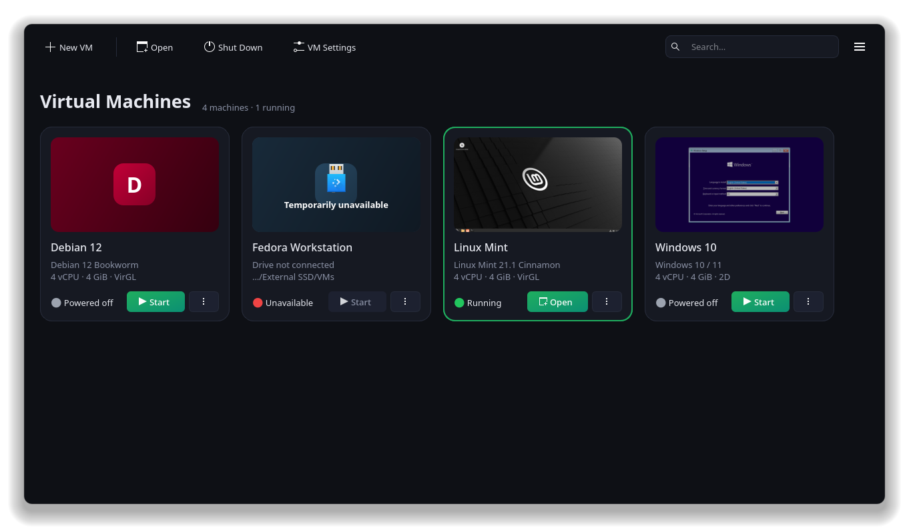
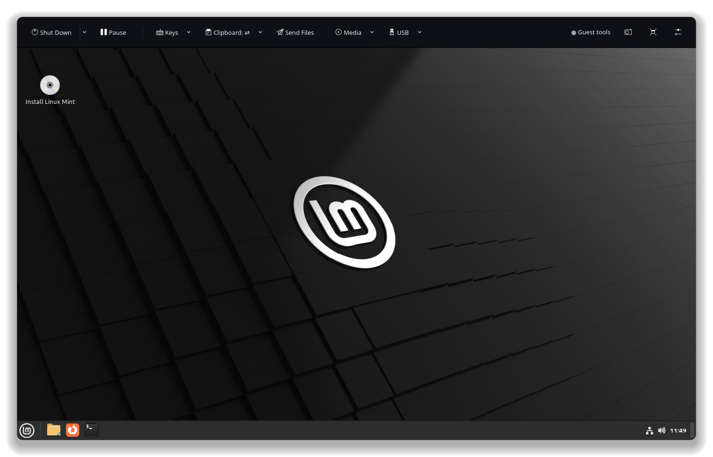
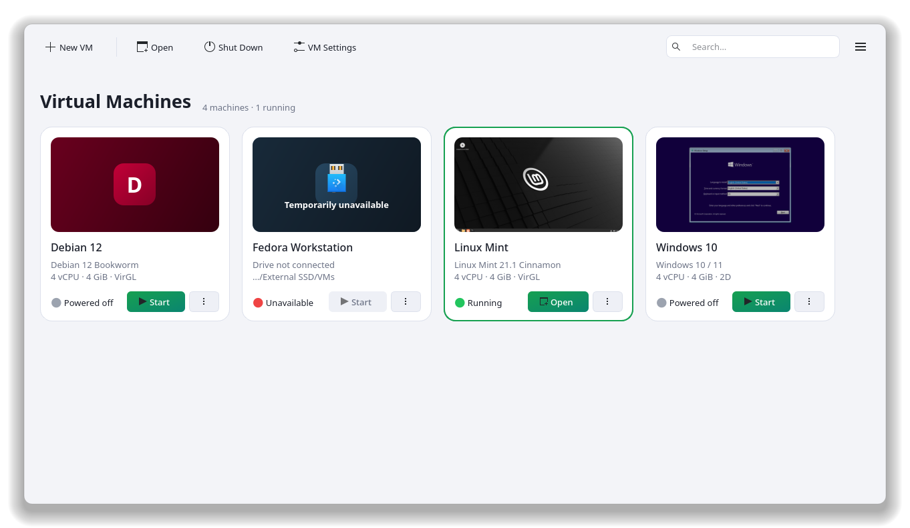
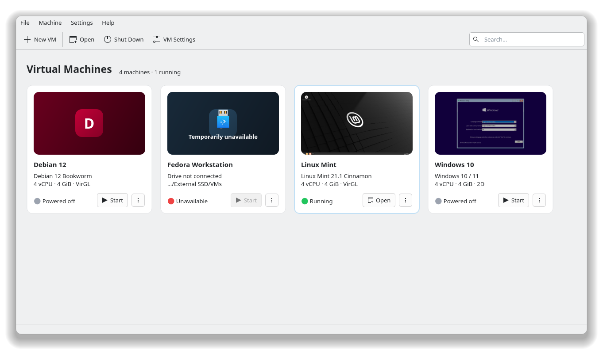
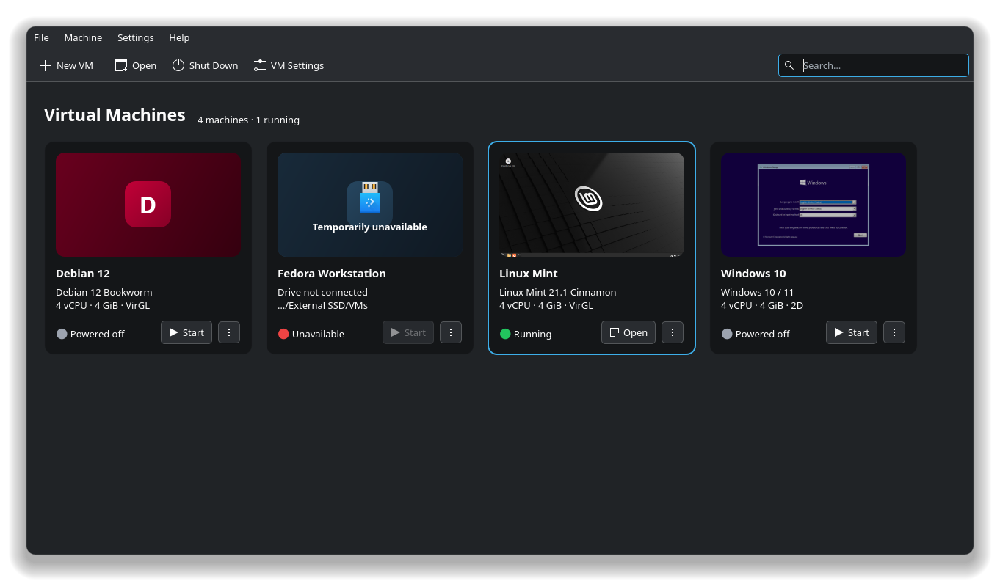
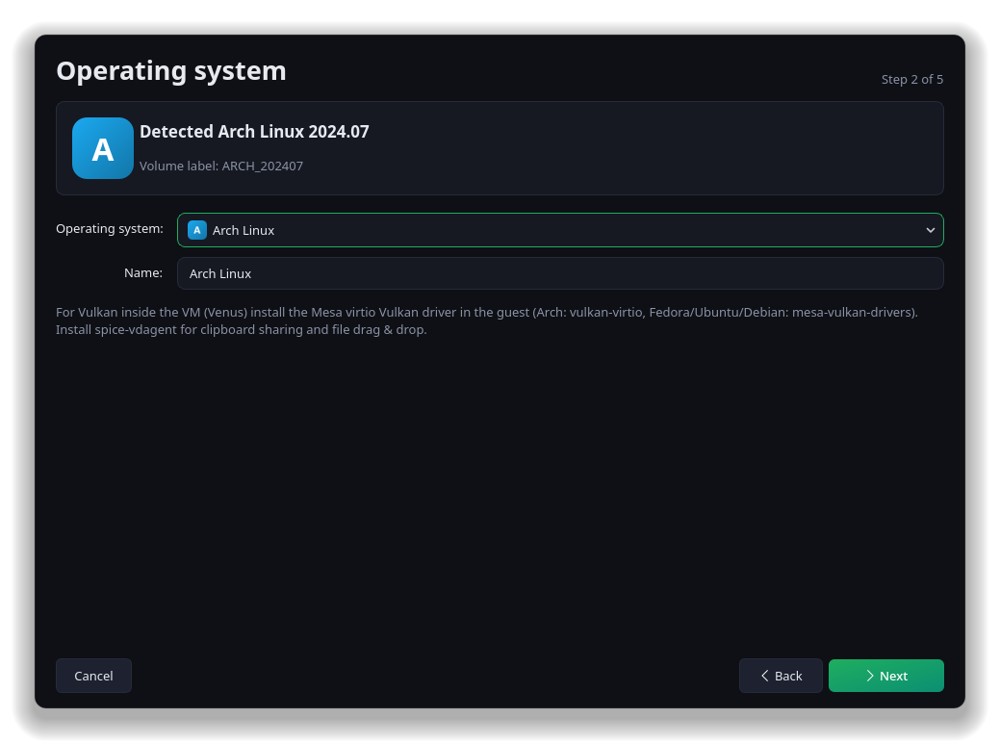
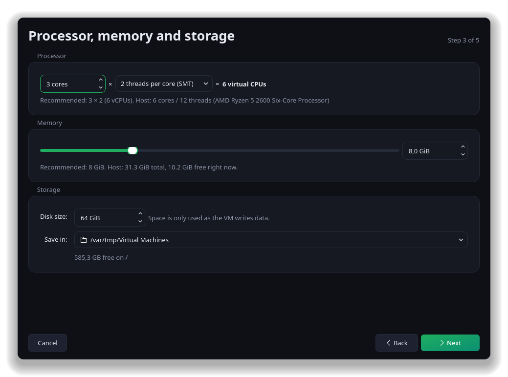
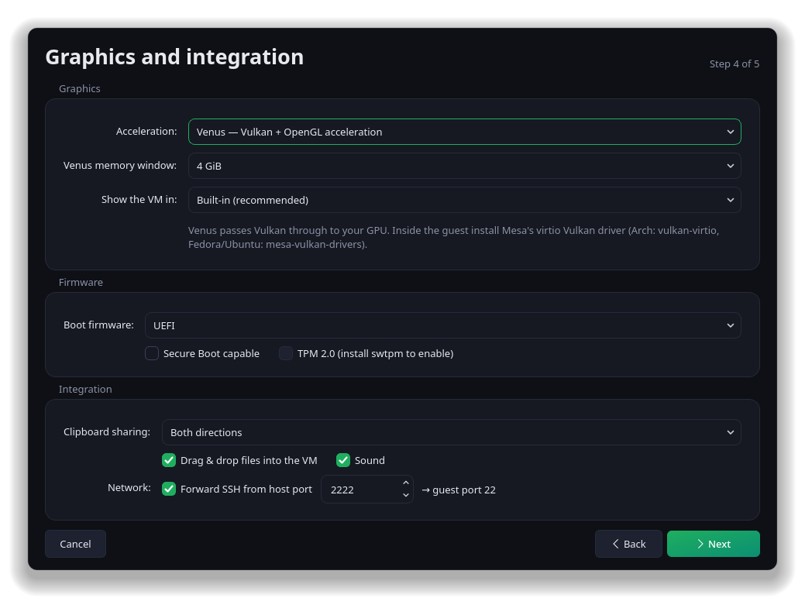
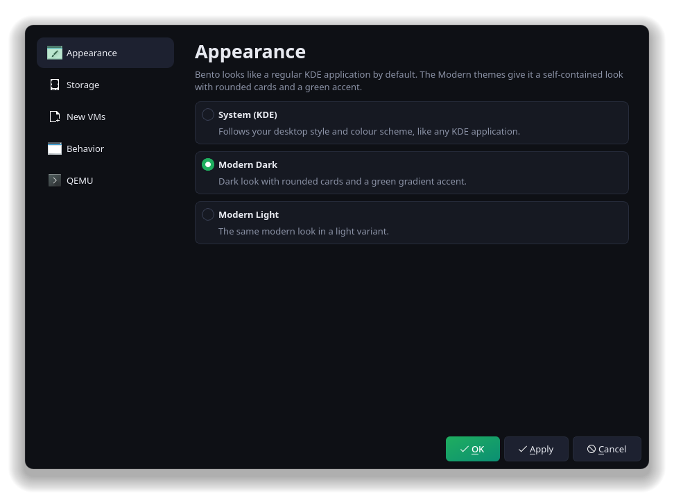

<p align="center">
  
</p>

<h1 align="center">BentoVM</h1>

<p align="center">
  <b>GPU-accelerated QEMU/KVM virtual machines, without the command line.</b><br>
  Venus (Vulkan) and VirGL acceleration · runs as your user · at home on KDE Plasma
</p>

<p align="center">
  
  
  
  
  
</p>

<p align="center">
  
</p>

BentoVM is a Qt front end for QEMU/KVM that treats **Venus** (Vulkan) and VirGL GPU
acceleration as first-class citizens, so GPU-accelerated VMs no longer need a
hand-written `qemu-system-x86_64` command line.

VMs run as **your user** (no root, no libvirt), each as an independent QEMU
process. Closing BentoVM, or BentoVM crashing, doesn't take your VMs down; BentoVM
reconnects to them on its next start. It looks like a regular KDE application
on Plasma, and uses its own Modern theme on other desktops such as GNOME.

## Features

- **Venus / VirGL / 2D graphics** per VM, shown in a built-in display (QEMU's
  D-Bus display with DMA-BUF frames imported through EGL into the window),
  or optionally in QEMU's own GTK/SDL window.
- **Storage locations**: one or more folders for VMs, one of them the default.
  VMs on a disconnected drive stay in the list as *Temporarily unavailable*
  and can't be booted until the drive is back.
- **Clipboard sharing** with a per-VM direction: both ways, host→guest,
  guest→host or off (switchable live from the VM window).
- **Drag & drop files** onto the VM screen (or onto its card) to copy them into
  the guest; they land in the guest user's Downloads folder.
- **USB passthrough**: plug host devices (game controllers, USB drives, …) into
  a running VM from the *USB* menu, or have them connected automatically
  whenever the VM starts.
- **Setup wizard**: pick an ISO (ISOs in `~/Downloads` and recently used ones
  are listed) or an existing disk image. The OS is detected from the ISO's
  volume label, with `osinfo-detect` as a fallback, and CPU (cores × threads)
  and RAM are recommended from the OS and your hardware. Everything stays adjustable.
- **Themes**: by default, the native style on desktops that provide one (KDE
  Plasma), otherwise *Modern Light* or *Modern Dark* to match your colour
  scheme. The Modern themes give a self-contained look with rounded cards and a
  green gradient accent. Icons always come from your icon theme.
- UEFI/BIOS, Secure Boot, TPM 2.0 (with `swtpm`), port forwarding (SSH by
  default for Linux guests), PipeWire/PulseAudio sound, CD/ISO hot-swap,
  screenshots, "send key" combos, and the generated QEMU command line in VM settings.

## Screenshots

<table>
  <tr>
    <td width="50%"></td>
    <td width="50%"></td>
  </tr>
  <tr>
    <td align="center"><sub>A VM in the built-in display, with clipboard, file drop and USB controls</sub></td>
    <td align="center"><sub>Modern Light theme</sub></td>
  </tr>
  <tr>
    <td></td>
    <td></td>
  </tr>
  <tr>
    <td align="center"><sub>System theme: a regular KDE application (Breeze)…</sub></td>
    <td align="center"><sub>…that follows your colour scheme (Breeze Dark)</sub></td>
  </tr>
  <tr>
    <td></td>
    <td></td>
  </tr>
  <tr>
    <td align="center"><sub>The setup wizard detects the OS from the ISO…</sub></td>
    <td align="center"><sub>…and recommends CPU and memory for your hardware</sub></td>
  </tr>
  <tr>
    <td></td>
    <td></td>
  </tr>
  <tr>
    <td align="center"><sub>Venus, clipboard direction, file drop and SSH in one step</sub></td>
    <td align="center"><sub>Pick the look in Settings → Appearance</sub></td>
  </tr>
</table>

The library at the top shows a running VM, two powered-off ones and a VM whose
external drive is unplugged (*Temporarily unavailable*).

## Installation

### AppImage

Download `BentoVM-<version>-x86_64.AppImage` from the
[Releases](https://github.com/hyperstown/bento-vm/releases) page, then:

```sh
chmod +x BentoVM-*-x86_64.AppImage
./BentoVM-*-x86_64.AppImage
```

The AppImage contains BentoVM, Qt and KDE's Breeze style and Plasma
integration, so on KDE Plasma it looks and behaves like a native application
(your fonts, colours and file dialogs). On GNOME and other desktops it uses the
Modern theme in your colour scheme, with your icon theme. QEMU, virglrenderer, OVMF and the GPU
drivers come from your system (see [Requirements](#requirements)). It runs on
distributions with glibc 2.39 or newer (Ubuntu 24.04, Fedora 40, Debian 13,
Arch and newer).

### Arch Linux (AUR)

Coming soon.

### Flatpak

Coming soon.

### From source

See [Build & run](#build--run).

## Requirements

BentoVM itself runs anywhere QEMU/KVM does; plain 2D and VirGL VMs work on any
recent distribution. **Venus** depends on fairly new host and guest software,
so on LTS distributions it may not be available yet.

### Host

| Component | Minimum | Notes |
|---|---|---|
| Linux kernel | any with KVM | **6.13+ for Venus**, 6.16+ in the Intel cases under [GPU notes](#gpu-notes) |
| QEMU | 9.2 | First release with Venus. Needs the D-Bus display (`ui-dbus`) and virtio-gpu GL modules. 11.0+ recommended |
| virglrenderer | 1.0.0 | Built with Venus enabled (OpenGL-only VirGL works from 0.8.2) |
| Vulkan driver | see [GPU notes](#gpu-notes) | Only needed for Venus |
| OVMF (edk2) | – | For UEFI guests (BIOS guests work without it) |
| libosinfo | optional | Better ISO detection (`osinfo-detect`) |
| swtpm | optional | TPM 2.0, e.g. for Windows 11 |
| spice-gtk | optional | Password-less, one-time USB access (its ACL helper) |

Your user needs read/write access to `/dev/kvm` (usually via the `kvm` group).

### Linux guests

| For | Needs |
|---|---|
| Venus (Vulkan) | Linux 5.16+ and Mesa 24.2+ with the Venus driver (Arch: `vulkan-virtio`; Fedora/Debian/Ubuntu: `mesa-vulkan-drivers`) |
| Clipboard and file drop | `spice-vdagent` |

Check Venus inside the guest with `vulkaninfo --summary`: the device should
read *Virtio-GPU Venus (…your host GPU…)*. If it only lists llvmpipe, see the
notes below and the VM's log (*⋮ menu on the VM card → Open Log*).

Windows guests have no Venus/VirGL driver and use the 2D display. Install the
virtio-win guest tools there for clipboard and file drop.

### GPU notes

Venus maps host GPU memory directly into the guest, so it depends on the host
GPU driver and KVM. BentoVM is developed and tested on AMD (RADV). The rest of
this list follows [Mesa's Venus documentation](https://docs.mesa3d.org/drivers/venus.html).

- **AMD and Intel (Mesa RADV / ANV 21.1+)**: host kernel 6.13+.
- **Intel CPU with a discrete GPU (AMD or NVIDIA), or Intel Meteor Lake / `xe`
  driver**: host kernel 6.16+ and QEMU 11.0+. KVM must honor the guest's
  memory attributes (`-accel kvm,honor-guest-pat=…`). BentoVM adds
  `honor-guest-pat=auto` to Venus VMs automatically on QEMU 11+; QEMU then
  enables it only if the kernel supports it. With an older QEMU on an Intel
  CPU, BentoVM shows a warning when the VM starts.
- **NVIDIA (proprietary driver)**:
  - Venus needs driver **570.86 or newer**. With older drivers, use VirGL or 2D.
  - On an Intel CPU, the point above applies too.
  - The built-in display and VirGL go through EGL/GBM, which needs NVIDIA's kernel
    modesetting: `cat /sys/module/nvidia_drm/parameters/modeset` should print
    `Y`. This is the default since driver 560; otherwise add `nvidia_drm.modeset=1`
    to the kernel command line.
  - If the built-in display stays black, switch the VM to *QEMU window (GTK)*
    in *Settings → Display*.
  - Nouveau/NVK isn't on Mesa's tested list for Venus.

Mesa notes that Venus relies on implementation-defined driver behavior, so it
isn't guaranteed to work on every driver that meets these minimums.

## Build & run

Build dependencies: CMake 3.21+, a C++20 compiler, Qt 6.7+ (Widgets, Network,
OpenGL, OpenGLWidgets, Concurrent), GLib/GIO, EGL headers and
spice-protocol 0.14+. For example, on Arch Linux:

```sh
sudo pacman -S --needed cmake ninja qt6-base glib2 libglvnd spice-protocol \
                        qemu-desktop virglrenderer edk2-ovmf
# optional: libosinfo swtpm spice-gtk
```

Other distributions have equivalent packages (usually the `-devel` / `-dev`
variants for building).

```sh
cmake -B build -G Ninja
cmake --build build
./build/bento-vm
```

To get a launcher entry and icon, install it:

```sh
cmake --install build --prefix ~/.local
```

Running straight from the build folder works too, but Qt then logs
`Failed to register with host portal … App info not found for 'io.github.hyperstown.BentoVM'`
because the desktop portal can't find the app's desktop file. It's harmless and
disappears once BentoVM is installed.

## Importing an existing VM

*New VM → Use an existing disk image* boots a disk you already have (qcow2,
raw, VMDK, VDI…), either in place or copied into the VM folder. Since BentoVM
doesn't run QEMU as root, the file must be readable and writable by your user
(images under `/var/lib/libvirt/images`, for example, may need
`sudo chown $USER: …`).

Imported disks default to **BIOS** firmware and the **SATA** bus, which is what
a plain `qemu-system-x86_64 -hda disk.qcow2` uses on q35, so existing installs
keep booting. You can switch to VirtIO later in *Settings → Storage* once the
guest's initramfs includes `virtio_blk`.

## USB devices

The *USB* menu in the VM window lists the host's USB devices; tick one to hand
it to the running VM, untick it to give it back. A device stays assigned to its
USB port, so a controller that resets or switches modes stays connected.
Devices in *Settings → USB* are connected automatically whenever the VM starts
and whenever they're plugged in while it runs.

USB device nodes are only accessible to root by default, and BentoVM doesn't run
QEMU as root. When you connect a device from the *USB* menu, BentoVM gets
one-time access to it:

- If spice-gtk's ACL helper is installed (spice-gtk comes with virt-viewer,
  virt-manager and GNOME Boxes), access is granted without a password and
  revoked as soon as you hand the device back or the VM stops.
- Otherwise BentoVM asks for your administrator password. You can choose
  *Allow This Time* (until the device is unplugged or the computer restarts) or
  *Always Allow* (a udev rule for that vendor:product ID).

Devices that connect automatically (*Settings → USB*) need the permanent rule,
since QEMU opens them on its own; use *Allow Access…* there. Rules live in
`/etc/udev/rules.d/70-bento-usb.rules`; delete a line (or the file) to revoke
access.

BentoVM asks for confirmation before taking a keyboard or mouse away from the
host, and warns if a USB drive is still mounted on the host.

## Keys in the VM window

- **Ctrl+Alt+F**: toggle full screen
- **Ctrl+Alt+G**: release the keyboard back to the host
- *Keys* menu: Ctrl+Alt+Del, Ctrl+Alt+F1…F12, Print, Super

## Where things live

| | |
|---|---|
| Settings | `~/.config/bento-vm/bento-vm.conf` |
| Default VM location | `~/.local/share/bento-vm/machines/<name>/` (`vm.json`, `disk.qcow2`, `efivars.fd`) |
| Library cache (offline VMs) | `~/.local/share/bento-vm/library.json` |
| QEMU logs | `~/.local/state/bento-vm/logs/<vm-id>.log` |
| Sockets / pid files | `$XDG_RUNTIME_DIR/bento-vm/<vm-id>/` |

A VM folder is self-contained: copy it anywhere and add it back with
*File → Add Existing BentoVM Folder*.

## How it works

- `core/QemuCommand` turns a `vm.json` into a QEMU command line
  (`virtio-vga-gl,hostmem=…,blob=true,venus=true` with memfd-backed RAM).
- `core/Vm` launches QEMU detached and controls it over QMP (`core/QmpClient`).
- `display/DBusDisplay` passes QEMU one end of a socket pair via QMP
  `getfd` + `add_client` (`-display dbus,p2p=yes,gl=on`), registers a
  listener over GDBus and receives `ScanoutDMABUF`/`UpdateDMABUF`. Each update is
  acknowledged after drawing, which paces the guest.
- `display/DisplayWidget` imports the DMA-BUFs with `EGL_EXT_image_dma_buf_import`
  into a `QOpenGLWidget`, maps input (evdev → QEMU key codes) and asks the
  guest to follow the window size (`SetUIInfo`).
- `agent/VdAgent` speaks the SPICE agent protocol directly on the
  `com.redhat.spice.0` port: clipboard with direction control and file
  transfer, no SPICE server involved.

## Tests

```sh
cmake -B build -DBENTO_BUILD_TESTS=ON && cmake --build build
```

`display_test`, `ui_test`, `lifecycle_test`, `usb_test` and `usb_ui_test`
drive real QEMU instances. Run
them inside a headless compositor (e.g. `kwin_wayland --virtual --socket t`,
then `WAYLAND_DISPLAY=t`) with throwaway `XDG_*_HOME` directories.
`vdagent_test` talks to a real `spice-vdagentd` (e.g. in a container, with the
virtio port emulated by `socat PTY,… UNIX-LISTEN:…`).

`create_test` checks that VM creation never blocks the UI and that every
failure explains itself (with a fake `qemu-img` that is slow, silent, crashes or
can't start). `create_ui_test <out> <iso> <folder> <GiB>` clicks through the New
VM wizard and creates a VM in the given folder, including Cancel.

`packaging/appimage/test-distros.sh` smoke-tests the AppImage in containers on
Fedora, Ubuntu 24.04 and 26.04 and Arch (or the distribution images you pass),
as in a KDE Plasma and in a GNOME session. `theme_shot` prints the theme, style
and icon theme a build picks and saves screenshots of its windows.

`readme_shots` regenerates the images in `docs/screenshots/` from a staged
sample library (it boots a Linux live ISO and a Windows installer ISO).

## Known limitations

- On Wayland, compositor shortcuts (Meta, Alt+Tab) still go to the host; use
  the *Keys* menu.
- Folders can't be dropped yet (zip them first).
- In QEMU-window mode the clipboard is both-ways-or-off and file drop is unavailable.

## License

BentoVM is free software: you can redistribute it and/or modify it under the
terms of the GNU General Public License as published by the Free Software
Foundation, either version 2 of the License, or (at your option) any later
version. See [LICENSE](LICENSE).
